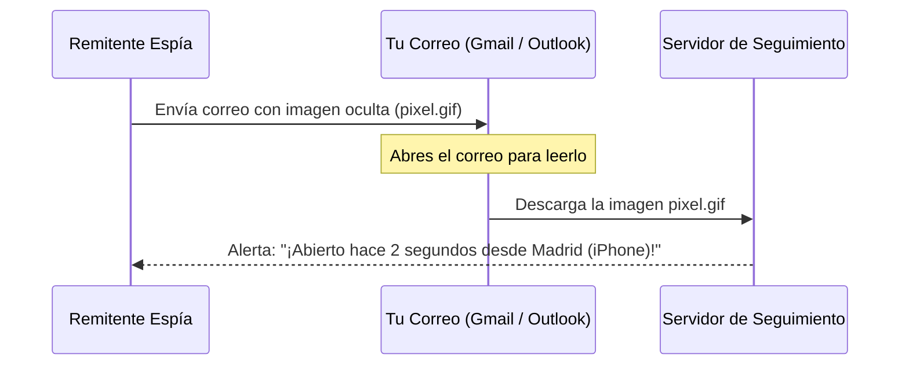

Envías un correo electrónico a un cliente, a una empresa o a un conocido y, a los pocos minutos, esa persona te llama por teléfono diciendo: *"Veo que acabas de leer mi propuesta"*. No es magia ni casualidad: han utilizado un **píxel de seguimiento o correo espía (tracking pixel)**.

Plataformas de marketing y extensiones comerciales muy populares (como *Mailtrack*, *HubSpot*, *Salesforce* o *Superhuman*) insertan dentro de los mensajes una imagen microscópica y transparente de apenas **1x1 píxel**. 

En cuanto abres el mensaje en tu aplicación de correo, esa imagen se descarga automáticamente de los servidores del remitente, revelándole en tiempo real:
- El día y la hora exacta a la que abriste el correo.
- Cuántas veces lo has vuelto a releer.
- Tu dirección IP pública y la ciudad desde la que te conectas.
- El modelo de tu móvil o sistema operativo (Windows, iPhone, Android).

A continuación te enseñamos a neutralizar este rastreo invasivo tanto en Gmail como en Outlook.

> **¿Sospechas de un enlace en un correo electrónico?** Analiza su seguridad antes de hacer clic con nuestro [Detector de Enlaces Sospechosos](/herramientas/detector-enlaces).

---

## Cómo funciona un píxel espía invisible

El mecanismo técnico es tan simple como efectivo:

Dado que el protocolo de correo electrónico HTML permite cargar imágenes alojadas en servidores externos, el acto de descargar esa imagen minúscula actúa como un "chivato" automático de lectura.

---

## Solución 1: Bloquear la carga automática de imágenes en Gmail

Al impedir que Gmail descargue imágenes externas de forma automática, el píxel espía jamás se activará:

### En la versión web de Gmail (Ordenador):
1. Abre Gmail y haz clic en el icono del engranaje en la esquina superior derecha > **Ver todos los ajustes**.
2. En la pestaña **General**, desplázate hacia abajo hasta encontrar el apartado **Imágenes**.
3. Cambia la opción a: **"Preguntar antes de mostrar imágenes externas"**.
4. Desplázate hasta el final de la página y haz clic en **Guardar cambios**.

### En la aplicación móvil de Gmail (Android e iPhone):
1. Entra en el menú lateral de Gmail > **Ajustes**.
2. Toca sobre tu dirección de correo electrónico.
3. Desplázate hasta el apartado de **Imágenes** y selecciona **"Preguntar antes de mostrar imágenes externas (también inhabilita el contenido dinámico del correo electrónico)"**.

> **A partir de ahora:** Cuando abras un correo, verás el texto limpio. Si es una newsletter con fotos que deseas ver expresamente, verás un botón superior que dice *"Mostrar imágenes de este remitente"*.

---

## Solución 2: Bloquear imágenes externas en Microsoft Outlook

Outlook cuenta con una protección nativa muy robusta desactivada por defecto en algunas cuentas:

1. En la aplicación de escritorio de Outlook, ve a **Archivo > Opciones**.
2. Entra en **Centro de confianza > Configuración del Centro de confianza**.
3. Haz clic en **Descarga automática**.
4. Asegúrate de que esté marcada la casilla: **"No descargar automáticamente imágenes en mensajes de correo electrónico HTML o elementos RSS"**.

---

## Extensiones gratuitas para detectar y destruir píxeles espía

Si prefieres seguir viendo imágenes normales pero quieres que el navegador bloquee y te avise cuando un correo contiene un rastreador comercial:

- **Trocker:** Extensión de código abierto disponible para Google Chrome, Firefox y Brave. Analiza el código HTML de cada correo entrante, neutraliza los enlaces de seguimiento de más de 100 plataformas espía y muestra un pequeño icono de advertencia indicándote qué empresa intentó rastrearte.
- **PixelBlock:** Bloquea de forma silenciosa cualquier intento de seguimiento por píxel en la interfaz web de Gmail.

---

## Preguntas Frecuentes (FAQ)

### ¿Apple Mail protege contra estos píxeles de seguimiento?

**Respuesta**: Sí. A partir de iOS 15 y macOS Monterey, Apple incorporó la función nativa llamada **Protección de la privacidad en Mail (Mail Privacy Protection)**. Esta característica descarga todas las imágenes de los correos a través de servidores proxy anónimos de Apple antes de que los abras, ocultando tu dirección IP real y haciendo que el remitente crea que todos los correos han sido leídos de inmediato, inutilizando las estadísticas del rastreador.

### ¿El remitente sabrá que he bloqueado su píxel espía?

**Respuesta**: No. Para el remitente simplemente parecerá que el correo aún no ha sido abierto o que ha quedado archivado en la bandeja de entrada.

### ¿Bloquear imágenes afecta a la seguridad contra virus en correos?

**Respuesta**: Al contrario, mejora drásticamente tu seguridad. Muchos ataques de phishing y exploits de día cero se aprovechan de scripts maliciosos ocultos en formatos de imagen SVG o archivos incrustados. Bloquear la descarga automática de contenido remoto es una de las recomendaciones fundamentales de ciberseguridad corporativa.
