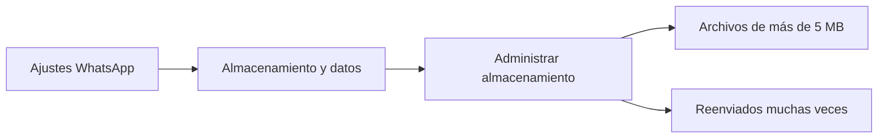

El problema del almacenamiento colapsado es una pesadilla recurrente para millones de usuarios de smartphones: compras un teléfono con 128 GB o 256 GB de memoria y, en cuestión de meses, recibes el fatídico aviso de *"Espacio de almacenamiento casi lleno"*.

En el 80% de los casos, el principal culpable no son las fotos de tus vacaciones ni las aplicaciones que instalas, sino los **grupos multitudinarios de WhatsApp** (familias, amigos del colegio, vecinos o trabajo) donde se comparten a diario decenas de memes, capturas de pantalla, vídeos absurdos en alta resolución y notas de voz que se descargan de forma automática en la memoria interna de tu dispositivo.

A continuación te mostramos la configuración definitiva para detener este drenaje de memoria y recuperar gigas enteros en menos de cinco minutos.

> **¿Quieres saber cuántos gigabytes reales tienes disponibles?** Utiliza nuestro [Conversor de Almacenamiento y Capacidad Real](/herramientas/conversor-almacenamiento).

---

## Paso 1: Desactivar la descarga automática de archivos multimedia

Por defecto, WhatsApp descarga absolutamente todo lo que recibes cuando estás conectado a una red Wi-Fi:

### En teléfonos Android:
1. Abre WhatsApp y pulsa en los tres puntos verticales de la esquina superior derecha > **Ajustes**.
2. Entra en el apartado **Almacenamiento y datos**.
3. En la sección *Descarga automática*, pulsa sobre:
   - **Descargar con datos móviles:** Desmarca todas las casillas (Fotos, Audio, Vídeos, Documentos).
   - **Descargar con Wi-Fi:** Desmarca igualmente **todas las casillas**, especialmente *Vídeos* y *Documentos*.
4. A partir de ahora, cuando alguien te envíe un meme o vídeo, verás una vista previa borrosa con el botón de flecha hacia abajo; solo se descargará en tu teléfono si tú decides tocarlo expresamente.

### En iPhone (iOS):
1. Entra en **Ajustes de WhatsApp > Almacenamiento y datos**.
2. En el bloque de *Descarga automática de archivos*, entra uno a uno en **Fotos, Audio, Vídeos y Documentos** y cámbialos a **"Nunca"**.

---

## Paso 2: Ocultar las fotos de WhatsApp de tu galería general

Si descargas una foto para verla dentro de un chat pero no quieres que contamine el carrete de tu galería personal de Google Fotos o Apple Fotos:

1. Ve a **Ajustes de WhatsApp > Chats**.
2. Busca la opción **Visibilidad de archivos multimedia**.
3. Desactiva el interruptor: *"Mostrar en la galería de tu teléfono los archivos multimedia nuevos que descargues"*.
4. En iPhone, esta opción se llama **Guardar en Fotos** y debes dejarla en **"Nunca"**.

> **Ajuste por chat individual:** Si tienes un grupo familiar especialmente activo, abre ese chat, toca en el nombre superior del grupo, entra en **Visibilidad de archivos multimedia** y selecciona **"No"**. Así no afectará a los chats de trabajo o conversaciones importantes.

---

## Paso 3: Usar el Administrador de Almacenamiento nativo de WhatsApp

WhatsApp cuenta con una potente herramienta interna para borrar los archivos más pesados sin tener que leer los chats uno por uno:



1. Ve a **Ajustes > Almacenamiento y datos > Administrar almacenamiento**.
2. Verás dos secciones vitales:
   - **De más de 5 MB:** Muestra vídeos largos que se comen tu memoria. Puedes ordenarlos por tamaño de mayor a menor y eliminarlos con un toque.
   - **Reenviados muchas veces:** Memes virales y cadenas que ya no necesitas.
3. Debajo verás la lista de chats ordenada por el espacio que ocupan. Entra en los grupos antiguos que ya no uses y pulsa *"Seleccionar todos > Eliminar"*.

---

## El truco avanzado del archivo `.nomedia` en Android

Si quieres que las imágenes de WhatsApp se guarden en tu disco pero que ninguna aplicación de galería las escanee ni las muestre:

1. Abre cualquier explorador de archivos en tu móvil (como *Files de Google*).
2. Ve a la carpeta interna: `Android/media/com.whatsapp/WhatsApp/Media/WhatsApp Images`.
3. Crea un archivo vacío nuevo y ponle exactamente por nombre:
   ```text
   .nomedia
   ```
4. El punto inicial indica a Android que ignore esa carpeta en la biblioteca multimedia de fotos del sistema, ocultando al instante miles de imágenes de tu carrete principal.

---

## Preguntas Frecuentes (FAQ)

### Si borro una foto de WhatsApp, ¿se borra también del chat de la otra persona?

**Respuesta**: No. Si eliminas el archivo multimedia desde tu administrador de almacenamiento local, solo se borra de la memoria física de tu dispositivo. La otra persona que lo envió o los demás integrantes del grupo continuarán teniendo su copia intacta en sus respectivos terminales.

### ¿Qué diferencia hay entre vaciar un chat y eliminar un chat?

**Respuesta**: "Vaciar un chat" borra todos los mensajes de texto, fotos y notas de voz que contiene la conversación, pero mantiene el contacto en tu lista principal de chats. "Eliminar un chat" borra absolutamente todo y además hace desaparecer la conversación de tu lista de chats activos.

### ¿Las notas de voz y documentos PDF se pueden borrar sin perder los textos?

**Respuesta**: Sí. Desde la herramienta interna de *Administrar almacenamiento* de WhatsApp puedes filtrar específicamente por tipo de archivo, permitiéndote borrar todos los audios y vídeos pesados manteniendo intacto el historial de texto escrito de tus conversaciones.
