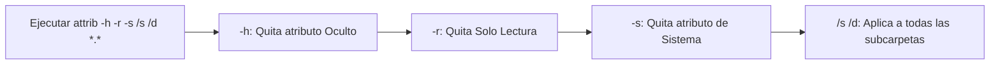

Conectas tu memoria USB (pendrive) o disco duro externo a un ordenador de la universidad, una imprenta o el trabajo y, al abrirlo de nuevo en tu casa, te invade el pánico: **todas tus carpetas, fotos y documentos de trabajo han desaparecido**, sustituidos por extraños iconos con una pequeña flecha que dicen ser "accesos directos" de apenas 1 KB.

Si intentas hacer doble clic sobre ellos, no se abre tu documento, sino que se ejecuta en segundo plano un script malicioso (habitualmente un troyano en VBScript o PowerShell) que infecta también tu ordenador personal.

La gran noticia es que **tus archivos originales NO han sido borrados**. El virus simplemente les ha cambiado los atributos del sistema para volverlos "invisibles" y ha creado accesos directos con sus mismos nombres. En esta guía te enseñamos a recuperarlos en menos de 2 minutos utilizando una sola línea de comandos en Windows, sin formatear ni perder nada.

> **¿Quieres evitar perder datos en el futuro?** Calcula tu plan de respaldo con nuestra [Calculadora de Almacenamiento para Copias de Seguridad (3-2-1)](/herramientas/calculadora-tamano-copia-seguridad).

---

## ¿Cómo funciona el virus de los accesos directos?

Este malware informático (conocido técnicamente como *Shortcut Virus* o *Trojan.VBS.Tupym*) sigue una estrategia en tres fases:

1. **Ocultación forzada:** Asigna a tus carpetas legítimas los atributos de sistema `Oculto (+h)` y `Sistema (+s)`. En Windows, por defecto, los archivos con estos atributos no se muestran en el Explorador.
2. **Suplantación:** Crea archivos `.lnk` (accesos directos) con los mismos nombres e iconos que tenían tus carpetas originales.
3. **Infección en cadena:** En las propiedades del acceso directo añade una orden para ejecutar un virus alojado en la papelera o en una carpeta oculta antes de abrir tu carpeta real.

---

## La solución definitiva con el comando ATTRIB (Paso a Paso)

No necesitas descargar programas dudosos de internet. Windows incluye de forma nativa la herramienta para restaurar los atributos de tus ficheros:

### Paso 1: Identificar la letra de tu memoria USB
1. Conecta el pendrive a tu PC.
2. Abre *Este equipo* y fíjate qué letra de unidad tiene asignada entre paréntesis (por ejemplo: `E:`, `F:` o `G:`).

### Paso 2: Abrir la consola de comandos como Administrador
1. Presiona la combinación de teclas **Windows + S** y escribe `cmd`.
2. Haz clic derecho sobre **Símbolo del sistema** y selecciona **Ejecutar como administrador**.

### Paso 3: Ejecutar la secuencia de rescate
1. Escribe la letra de tu unidad seguida de dos puntos y pulsa Enter. Por ejemplo, si tu USB es la unidad `E`:
   ```bash
   E:
   ```
2. Una vez situado en la raíz del pendrive, escribe exactamente este comando respetando los espacios:
   ```bash
   attrib -h -r -s /s /d *.*
   ```
3. Pulsa **Enter**.



4. El cursor parpadeará durante unos 10 a 30 segundos mientras procesa todos los archivos. Cuando vuelva a aparecer `E:\>`, el proceso habrá finalizado.

---

## Paso 4: Limpiar la memoria y eliminar el virus

Ahora abre tu memoria USB desde el Explorador de archivos:

1. Verás que han reaparecido todas tus carpetas originales (a veces dentro de una carpeta sin nombre o llamada `_` o `Drive`).
2. **Mueve tus archivos recuperados a una carpeta segura dentro de tu disco duro C:**.
3. En la memoria USB, **selecciona todos los accesos directos (.lnk) y bórralos** pulsando `Shift + Supr`.
4. Si ves archivos con extensión `.vbs`, `.js` o carpetas sospechosas de nombre extraño (como `Recycled`), elimínalos de inmediato.
5. Para garantizar una limpieza del 100%, una vez tengas tus archivos a salvo en tu PC, haz clic derecho sobre el USB y selecciona **Formatear (formato rápido en exFAT o NTFS)**. Vuelve a copiar tus archivos limpios dentro.

---

## Cómo desinfectar tu ordenador si abriste un acceso directo

Si hiciste doble clic en alguno de los accesos directos antes de leer este tutorial, el virus se instaló en el arranque de tu sistema:

1. Presiona **Ctrl + Shift + Esc** para abrir el Administrador de tareas.
2. Ve a la pestaña **Inicio** y revisa si hay algún elemento sospechoso con nombres como `wscript.exe`, `helper.vbs` o scripts de PowerShell desconocidos. Si lo ves, haz clic derecho y selecciona **Deshabilitar**.
3. Presiona **Windows + R**, escribe `%temp%` y borra todos los archivos temporales.
4. Ejecuta un examen completo gratuito con **Malwarebytes** o Windows Defender actualizado.

---

## Preguntas Frecuentes (FAQ)

### ¿Por qué mi antivirus no detectó el virus al conectar el USB?

**Respuesta**: Porque muchos de estos troyanos no utilizan archivos ejecutables binarios (`.exe`), sino scripts de texto estándar (`.vbs` o comandos de consola nativos de Windows). Al utilizar herramientas legítimas del propio sistema operativo para propagarse, los antivirus tradicionales basados en firmas pueden ignorarlos si no tienen activada la detección heurística avanzada.

### ¿El comando attrib borra algún archivo de mi memoria?

**Respuesta**: No, en absoluto. El comando `attrib` es exclusivamente un modificador de propiedades del sistema de archivos de Windows. Lo único que hace es retirar las marcas de "oculto" y "protegido por el sistema", haciendo que todo el contenido existente vuelva a ser visible en el explorador sin alterar ni un solo byte de su interior.

### ¿Cómo puedo evitar que mis memorias USB vuelvan a infectarse en otros PCs?

**Respuesta**: El método más eficaz es desactivar la función de reproducción automática (AutoRun / AutoPlay) de Windows: entra en *Ajustes de Windows > Bluetooth y dispositivos > Reproducción automática* y desactiva el interruptor general. De este modo, aunque insertes un pendrive infectado, ningún script podrá ejecutarse sin tu consentimiento expreso.
