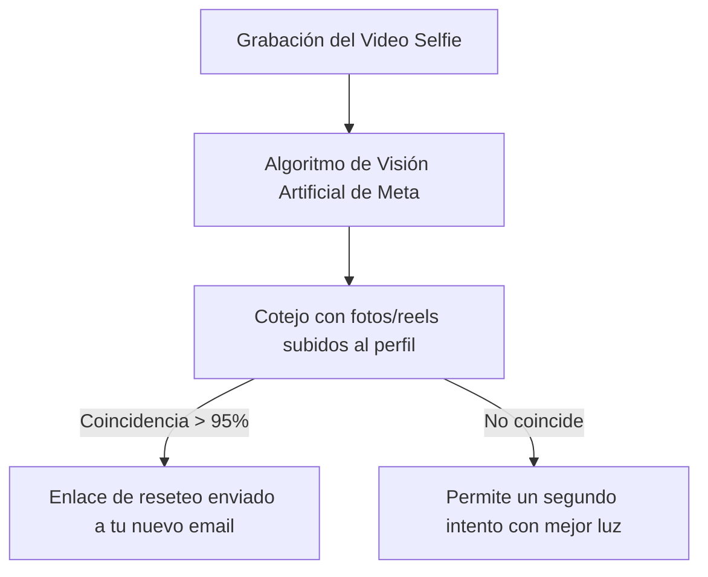

Sufrir el secuestro de tu perfil de Instagram o TikTok es una experiencia angustiosa: en cuestión de segundos, los ciberdelincuentes acceden a tu cuenta, cambian la dirección de correo electrónico vinculada, modifican el número de teléfono y activan una clave de doble factor (2FA) propia para que te resulte imposible restablecer la contraseña.

Acto seguido, suelen utilizar tu perfil para estafar a tus amigos pidiéndoles dinero o promocionando falsas inversiones en criptomonedas.

Afortunadamente, Meta y ByteDance han implementado un canal de rescate de emergencia biométrico diseñado específicamente para esta situación: **la verificación por Video Selfie oficial**. Aunque los hackers hayan cambiado todos tus datos de acceso, si en tu cuenta tenías publicadas fotos o vídeos donde se aprecie tu rostro, los algoritmos de visión artificial pueden restaurar tu propiedad legítima en menos de 24 horas.

> **Una vez recuperes el control:** Genera una clave robusta e indescifrable con nuestro [Generador de Contraseñas Seguras](/herramientas/generador-contrasenas).

---

## Paso 1: Iniciar el protocolo de cuenta hackeada en Instagram

No intentes pulsar en *"He olvidado mi contraseña"* de forma convencional, ya que el enlace de recuperación se enviaría al correo electrónico del hacker. Sigue esta ruta directa:

1. Abre la app de Instagram en tu teléfono móvil.
2. En la pantalla de inicio de sesión, toca en **"¿Has olvidado tus datos de acceso?"** (en iPhone: *"¿Has olvidado la contraseña?"*).
3. Escribe tu nombre de usuario original.
4. Cuando te ofrezca enviar un SMS o correo al buzón del atacante, pulsa abajo en: **"¿Necesitas más ayuda?"**.
5. Aparecerá una pantalla especial de soporte de Meta. Selecciona: **"Mi cuenta ha sido hackeada"**.

---

## Paso 2: La prueba del Video Selfie Facial

Meta te hará una pregunta determinante: *¿Tienes fotos tuyas en tu cuenta?*

1. Selecciona la opción: **"Sí, tengo una foto mía en mi cuenta"**.
2. Te solicitarán introducir una **dirección de correo electrónico NUEVA y segura** a la que solo tú tengas acceso (no uses la antigua vulnerada).
3. Instagram abrirá la cámara frontal de tu teléfono dentro de un óvalo con instrucciones guiadas:
   - Gira la cabeza lentamente hacia la derecha.
   - Gira la cabeza hacia la izquierda.
   - Inclina la cabeza hacia arriba y mira al frente.
4. Este breve clip de 5 segundos se encripta y se envía a los servidores de Meta.

---

## Paso 3: Recuperar el acceso y expulsar al atacante

En un plazo de entre **2 y 24 horas laborales**, recibirás un correo oficial de `security@mail.instagram.com`:

1. El mensaje contendrá un **enlace exclusivo de desbloqueo** de un solo uso y un código de rescate de 8 dígitos.
2. Abre el enlace desde el mismo smartphone donde grabaste el selfie.
3. Establece una contraseña nueva de al menos 16 caracteres.
4. **Paso crítico:** Ve a *Configuración > Centro de cuentas > Contraseña y seguridad > Dónde has iniciado sesión* y pulsa en **"Cerrar sesión en todos los demás dispositivos"** para desconectar al hacker de inmediato.
5. Desactiva la app de autenticación del atacante y activa tu propio Google Authenticator.

---

## Cómo actuar si el hackeo ha sido en TikTok

En TikTok el procedimiento se realiza a través de su formulario prioritario de soporte:

1. Entra desde el navegador en `tiktok.com/legal/report/feedback`.
2. En el tema, selecciona **"Denunciar un problema de seguridad / Cuenta comprometida"**.
3. Aporta datos históricos irrefutables:
   - Fecha exacta de creación de la cuenta (o mes aproximado).
   - Modelo exacto del primer móvil con el que iniciaste sesión (ej. *Samsung Galaxy S21*).
   - Capturas de recibos si compraste monedas de TikTok o hiciste promociones de vídeos.
4. El equipo de soporte humano restablecerá la vinculación de tu número telefónico tras validar tu titularidad.

---

## Preguntas Frecuentes (FAQ)

### ¿Qué pasa si en mi cuenta de Instagram solo subía fotos de paisajes o de mi empresa?

**Respuesta**: Si en tu cuenta nunca publicaste fotos donde se aprecie claramente tu rostro, el sistema de Video Selfie automático no podrá cotejar tu identidad biométrica. En ese caso, en el paso inicial debes seleccionar *"No, no tengo fotos mías"* para ser redirigido a la verificación manual documental, donde te solicitarán presentar un documento de identidad oficial (DNI o pasaporte) que coincida con el nombre legal registrado en la cuenta.

### ¿Instagram conserva mi grabación facial en sus bases de datos?

**Respuesta**: No. Según la política de privacidad oficial de Meta, los vídeos de verificación facial son analizados exclusivamente por algoritmos de reconocimiento biométrico temporal y **se eliminan de forma permanente de sus servidores en un plazo máximo de 30 días** tras completar la verificación.

### ¿Por qué los hackers piden un rescate por WhatsApp para devolver la cuenta?

**Respuesta**: Es una táctica de extorsión habitual. Jamás pagues dinero ni compres tarjetas de regalo si te contactan por WhatsApp prometiendo devolverte el perfil: en el 99% de los casos se quedan con el dinero y no entregan los accesos. El único método seguro y legal para restaurar tu cuenta es a través de los canales oficiales de soporte de la plataforma.
