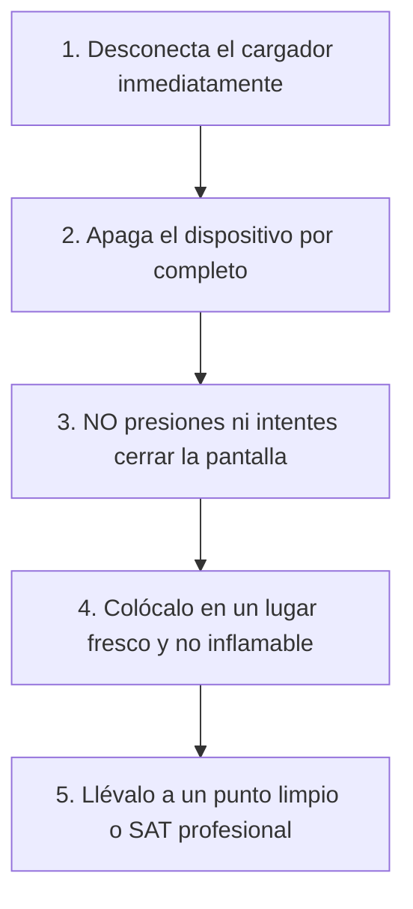

Una batería de iones de litio que comienza a hincharse es una de las emergencias de hardware más peligrosas a las que puede enfrentarse cualquier usuario. A diferencia de un componente que simplemente deja de funcionar, una celda de litio con sobrepresión interna almacena gases altamente inflamables sometidos a una tensión constante.

Si la funda de tu móvil encaja con dificultad, ves una separación entre la pantalla y el marco de aluminio, o el touchpad de tu ordenador portátil se ha vuelto rígido y no hace "clic", es muy probable que estés ante una **batería hinchada (swollen battery)**.

En este artículo te enseñamos a identificar los síntomas inequívocos y el protocolo de seguridad obligatorio que debes seguir de inmediato.

> **¿Quieres cuidar la salud de tus dispositivos?** Revisa nuestra [Calculadora de Tiempo de Carga de Batería](/herramientas/calculadora-tiempo-carga-bateria) para evitar sobrecargas y ciclos de calentamiento innecesarios.

---

## Síntomas visuales y mecánicos de una batería hinchada

Las baterías de polímero de litio (Li-Po) no se rompen de forma instantánea; generan gases de descomposición interna que van empujando las piezas circundantes:

| Dispositivo | Señal de alarma principal | Segundo síntoma común |
| :--- | :--- | :--- |
| **Teléfono Móvil** | La pantalla o la tapa trasera de cristal se despegan solas | Manchas amarillentas o distorsión de color en el panel OLED/LCD |
| **Portátil (Laptop)** | **El touchpad se eleva** y ya no permite hacer clic físico | El ordenador cojea sobre una mesa plana porque la base se abomba |
| **Tablet / iPad** | El cristal frontal presenta una curva convexa hacia fuera | La autonomía pasa del 80% al 0% en cuestión de segundos |

---

## La prueba de la mesa plana: Cómo confirmar la sospecha

1. Retira la funda protectora de plástico o silicona de tu teléfono móvil.
2. Coloca el dispositivo sobre una superficie completamente plana (una mesa de cristal o mármol).
3. Intenta hacerlo girar suavemente con un dedo como si fuera una peonza:
   - Si el teléfono gira fácilmente sobre su propio centro, **la tapa trasera se ha abombado**.
   - Colócalo ahora boca abajo (con la pantalla contra la mesa) y repite la prueba para comprobar si el cristal frontal está curvado.

---

## Protocolo de seguridad urgente: Qué debes hacer AHORA MISMO

Si confirmas que la batería está hinchada, sigue estas normas estrictas:

### 1. NUNCA lo vuelvas a conectar a la corriente
El paso de electricidad acelera la electrólisis interna y eleva la temperatura, lo que puede provocar un evento de **fuga térmica (thermal runaway)** y deflagración con fuego químico.

### 2. NO intentes pincharla con un alfiler
Algunos usuarios cometen la imprudencia suicida de pinchar la bolsa de la batería para "sacarle el gas". En cuanto el litio entra en contacto con el oxígeno del aire ambiente, se produce una reacción exotérmica violenta con llamas instantáneas y humo tóxico blanco.

### 3. Deposítalo en una superficie no inflamable
Coloca el teléfono en el suelo de baldosas o dentro de un recipiente metálico o de cerámica, alejado de cortinas, madera, papeles o camas, mientras gestionas su reparación.

---

## ¿Por qué se hinchan las baterías de litio?

Las causas más frecuentes se deben a factores térmicos y químicos:
- **Calor extremo sostenido:** Dejar el teléfono en el salpicadero del coche en verano a más de 50°C degrada rápidamente los separadores de polímero.
- **Cargadores defectuosos sin certificación:** Cargadores ultra baratos de tiendas no verificadas que carecen de microchip de corte automático e inyectan picos de sobretensión.
- **Envejecimiento químico natural:** Tras 3 o 4 años de uso intenso (más de 1.000 ciclos), los electrodos acumulan sedimentos de litio metálico que reaccionan con el electrolito líquido.

---

## Preguntas Frecuentes (FAQ)

### ¿Se puede seguir usando un móvil con la batería un poco hinchada si funciona bien?

**Respuesta**: Rotundamente no. Una batería deformada ha perdido su integridad estructural. La más mínima presión accidental (por ejemplo, llevarlo en el bolsillo ajustado de un pantalón o una caída leve) puede romper el separador interno de las celdas y provocar un cortocircuito con llamas inmediatas.

### ¿Dónde debo tirar una batería hinchada si la he desmontado?

**Respuesta**: Jamás debes tirarla a la basura doméstica ni a los contenedores de reciclaje ordinarios de la calle. Debes llevarla a un Punto Limpio municipal especializado en residuos peligrosos (RAEE) o entregarla en el servicio técnico oficial de la marca para su neutralización química.

### ¿La garantía del fabricante cubre una batería hinchada?

**Respuesta**: En la gran mayoría de marcas (como Apple, Samsung o Dell), si el equipo se encuentra dentro del periodo de garantía legal y no ha sufrido golpes externos ni daños por agua, la sustitución de la batería deformada se realiza sin coste, ya que se considera un defecto de seguridad de los componentes.
