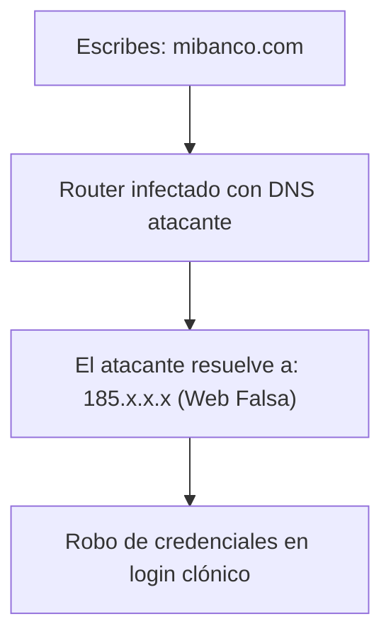

Cuando pensamos en ciberataques, solemos imaginar virus descargados en el ordenador o troyanos en el teléfono móvil. Sin embargo, los atacantes más sofisticados tienen como objetivo primordial el aparato más descuidado de todo el hogar: **el router Wi-Fi**.

Si un ciberdelincuente consigue acceder al panel de administración de tu router, no necesita infectar tus dispositivos uno por uno. Basta con modificar un único ajuste silencioso: **los servidores DNS del router (DNS Hijacking o Secuestro de DNS)**.

A partir de ese instante, cuando escribes en tu navegador la dirección de tu banco o de tu correo electrónico, el router no te conecta al servidor real, sino a una copia clónica idéntica creada por los atacantes para capturar tus contraseñas y vaciar tus cuentas.

En esta guía te enseñamos a diagnosticar si tu red está comprometida y cómo expulsar a los intrusos de forma definitiva.

> **¿Quieres comprobar desde qué dirección IP te conectas a internet?** Comprueba los datos públicos de tu red con nuestra [Herramienta Cuál es Mi IP](/herramientas/mi-ip).

---

## Síntomas inequívocos de un router comprometido

Presta atención si experimentas cualquiera de estos comportamientos en varios dispositivos de tu casa:

| Síntoma observado | Diagnóstico de seguridad | Nivel de Riesgo |
| :--- | :--- | :--- |
| **Redirecciones a páginas extrañas** | Al entrar en webs conocidas, el navegador salta a dominios raros de apuestas o sorteos | 🔴 **Crítico (DNS Secuestrado)** |
| **Avisos constantes de certificado SSL** | Aparece el mensaje *"La conexión no es privada"* en webs con HTTPS | 🔴 **Crítico (Ataque Man-in-the-Middle)** |
| **La contraseña de administración no funciona** | No puedes entrar a `192.168.1.1` con la clave escrita en la pegatina | 🔴 **Crítico (Credenciales cambiadas)** |
| **Lentitud extrema y tráfico fantasma** | El router parpadea a máxima velocidad con todos los PCs apagados | 🟡 **Alto (Router en Botnet)** |

---

## Cómo comprobar los servidores DNS de tu router

El paso principal es verificar qué servidores de nombres está utilizando tu router para resolver las direcciones de internet:

1. Abre tu navegador web y escribe en la barra de direcciones:
   ```text
   192.168.1.1   (o 192.168.0.1)
   ```
2. Introduce el usuario y contraseña de administración (si nunca la cambiaste, suele estar en una pegatina debajo del aparato: ej. `admin / admin` o `admin / 1234`).
3. Dirígete a la sección **Ajustes de Red (WAN / Internet / DNS)**.
4. Observa las direcciones IP en los campos **DNS Primario** y **DNS Secundario**:
   - **Servidores seguros legítimos:** `1.1.1.1` / `1.0.0.1` (Cloudflare), `8.8.8.8` / `8.8.4.4` (Google) o las IPs de tu operadora local (Movistar, Orange, Vodafone).
   - **Servidores sospechosos:** Si ves direcciones IP extrañas procedentes de Rusia, Rumanía, Seychelles o servidores desconocidos que tú nunca configuraste, **tu router ha sido hackeado**.



---

## Protocolo de desinfección y blindaje en 4 pasos

Si confirmas que tu router ha sido alterado, debes resetearlo de fábrica de inmediato:

### Paso 1: Hard Reset físico (Restablecimiento de fábrica)
1. Con el router encendido, busca un pequeño orificio en la parte trasera que dice **RESET**.
2. Introduce la punta de un clip o alfiler y mantén presionado el botón interno durante **15 segundos continuos**.
3. Las luces del router parpadearán al unísono y el equipo se reiniciará con su configuración original de fábrica, eliminando cualquier script malicioso o configuración de DNS alterada.

### Paso 2: Cambiar la contraseña del panel de administración
1. Entra de nuevo a `192.168.1.1`.
2. El primer paso obligatorio debe ser cambiar la contraseña del usuario `admin`.
3. Establece una contraseña robusta de al menos 14 caracteres combinando mayúsculas, números y símbolos. **Nunca dejes la clave por defecto**.

### Paso 3: Configurar servidores DNS blindados
1. En la configuración WAN, asigna manualmente los servidores de Cloudflare con filtrado de malware:
   - **DNS Primario:** `1.1.1.2` (Bloqueo activo de malware)
   - **DNS Secundario:** `1.0.0.2`

### Paso 4: Desactivar la administración remota (Remote Management)
1. Busca en el menú de seguridad la opción llamada **Gestión Remota (Remote Management / WAN Access)**.
2. Asegúrate de que esté **desactivada**. Esto impide que cualquier persona desde el exterior de tu casa pueda intentar acceder al panel de login del router a través de internet.

---

## Preguntas Frecuentes (FAQ)

### ¿Cómo consiguen los hackers entrar a un router doméstico?

**Respuesta**: En más del 90% de los casos, los ciberdelincuentes utilizan bots automatizados que escanean internet buscando routers que conservan las contraseñas de fábrica (`admin / admin`) o que tienen vulnerabilidades conocidas sin parchear en el protocolo UPnP (Universal Plug and Play) y puertos de administración remota abiertos.

### ¿Un virus en mi router puede infectar mi móvil o televisor?

**Respuesta**: El router no infecta el sistema operativo de tu teléfono con archivos, pero al controlar el flujo de datos de toda la casa, puede redirigir tus descargas de actualizaciones a versiones falsas con malware o interceptar todas las peticiones no cifradas que salgan de tus dispositivos conectados a la red Wi-Fi.

### ¿Debo llamar a mi compañía telefónica para cambiar de router?

**Respuesta**: Si tras realizar un reseteo de fábrica y cambiar las contraseñas los ajustes continúan modificándose solos, es probable que el firmware del router tenga una vulnerabilidad de día cero no solucionable. En ese caso, ponte en contacto con tu operadora explicando la incidencia de seguridad para que te sustituyan el router por un modelo más moderno y actualizado.
