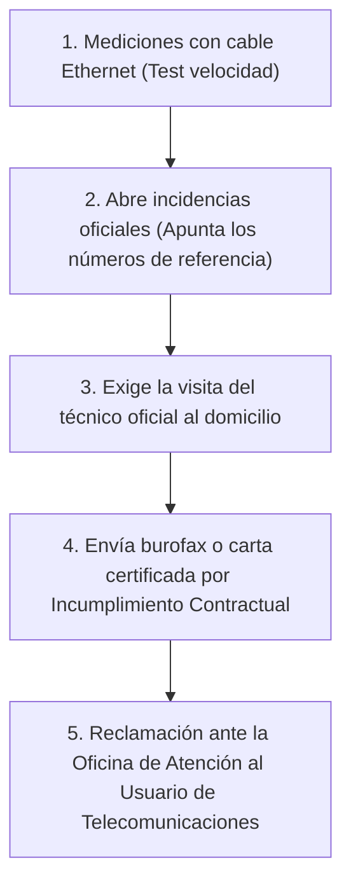

Contratas una oferta de fibra óptica de 600 Mbps o 1 Gbps con una compañía telefónica con un compromiso de permanencia de 12 o 24 meses a cambio de la instalación gratuita. A las pocas semanas descubres que el servicio es deficiente: caídas constantes de conexión durante tu jornada de teletrabajo, microcortes en videollamadas y una velocidad real que apenas llega al 20% de lo prometido.

Cuando llamas al servicio de atención al cliente para quejarte y pedir la baja, la operadora te amenaza con una respuesta clásica: *"Si se da de baja ahora, tendrá que pagar una penalización por permanencia de 180 € o 250 €"*.

Muchos usuarios pagan resignados o continúan sufriendo un mal servicio por miedo a ser incluidos en listas de morosos (como ASNEF). 

Sin embargo, la legislación de protección al consumidor y telecomunicaciones en España y la Unión Europea es tajante: **el compromiso de permanencia es un contrato bilateral**. Si la empresa no entrega el servicio con la calidad contratada, es ella quien está cometiendo un **incumplimiento contractual**, lo que te otorga el derecho legal a resolver el contrato con coste cero.

> **Paso previo indispensable:** Necesitas pruebas técnicas válidas. Realiza varias mediciones certificadas con nuestro [Test de Velocidad de Conexión](/herramientas/test-velocidad).

---

## Qué dice la Ley de Telecomunicaciones y Consumidores

En España, la Ley General de Telecomunicaciones y el Real Decreto Legislativo 1/2007 de Defensa de los Consumidores establecen tres principios inviolables:

1. **Incumplimiento de las condiciones esenciales:** Si la velocidad real es manifiestamente inferior a la pactada de forma reiterada, el consumidor tiene derecho a resolver el contrato sin penalización alguna.
2. **Proporcionalidad estricta:** Aunque la baja fuera voluntaria por tu parte, la penalización jamás puede ser fija; **debe prorratearse obligatoriamente por los días que falten para cumplir el contrato**. Cobrarte la penalización entera si ya has cumplido 10 de los 12 meses es ilegal.
3. **Modificaciones unilaterales:** Si tu operadora te avisa por carta o email de que va a subir el precio de tu tarifa (aunque sea 1 o 2 euros al mes), dispones legalmente de **30 días naturales para darte de baja sin pagar permanencia**, ya que han cambiado las condiciones pactadas unilateralmente.

---

## Guía paso a paso para darte de baja sin pagar un solo céntimo

Sigue escrupulosamente estos cuatro pasos para construir un expediente legally blindado:

### Paso 1: Recopila pruebas fehacientes
Las quejas verbales por teléfono no tienen validez legal ante arbitraje. Realiza pruebas conectando tu ordenador **directamente por cable Ethernet al router** (no por Wi-Fi) en diferentes momentos del día (mañana, tarde y noche) durante 3 o 4 días seguidos. Guarda capturas de pantalla completas donde se vea la fecha, la hora y los resultados.

### Paso 2: Exige el número de reclamación oficial en cada llamada
Cada vez que llames al servicio técnico para comunicar caídas:
- No cuelgues sin exigir al teleoperador el **número de incidencia o referencia oficial**.
- Apúntalo en una libreta con la fecha y el nombre del agente.
- Acumular al menos 3 números de incidencia en menos de un mes demuestra legalmente la reiteración de la avería técnica.

### Paso 3: Envía una comunicación formal de resolución
Si tras darles la oportunidad no solucionan el problema, solicita la baja formal mediante un canal con validez jurídica fehaciente (Burofax postal o email con certificado digital):
- *Texto tipo:* *"Por la presente comunico la resolución del contrato de la línea XXX por incumplimiento grave y continuado de las obligaciones contractuales de calidad de servicio (incidencias números: XXX, XXX, XXX), exonerándome expresamente de cualquier penalización por permanencia al amparo del artículo 1124 del Código Civil"*.

### Paso 4: Acude a la Oficina de Atención al Usuario de Telecomunicaciones
Si la compañía insiste en pasarte el recibo de penalización por el banco:
- Devuelve el recibo en tu banco.
- Presenta una reclamación gratuita online en la web del Ministerio para la Transformación Digital (`usuariosteleco.mineco.gob.es`). En el 90% de los casos con pruebas de avería, el ministerio falla a favor del usuario y anula la deuda de forma definitiva.

---

## Preguntas Frecuentes (FAQ)

### ¿Tengo que devolver el router de la compañía tras darme de baja?

**Respuesta**: Sí, obligatoriamente. La penalización por permanencia es un concepto distinto a la indemnización por no devolución del equipamiento. Dispones habitualmente de 30 días desde la baja para entregar el router y su alimentador en una tienda oficial o en una oficina de Correos con el código facilitado. Si no lo devuelves, te facturarán entre 60 € y 120 € por el coste del aparato.

### ¿Puedo hacer una portabilidad a otra compañía en lugar de darme de baja?

**Respuesta**: Sí, de hecho es lo más recomendable para no perder tu número de teléfono fijo ni quedarte días sin conexión. La nueva operadora tramitará la portabilidad automáticamente. Tu compañía antigua te emitirá la última factura con la penalización, la cual deberás impugnar mediante el procedimiento de reclamación de telecomunicaciones explicado arriba.

### ¿Qué ocurre si me amenazan con incluirme en una lista de morosos (ASNEF)?

**Respuesta**: La ley prohíbe taxativamente inscribir a un consumidor en un registro de morosidad si la deuda está siendo objeto de una reclamación formal administrativa (ante la Junta Arbitral de Consumo o Telecomunicaciones) hasta que no exista una resolución firme. Si te incluyen de forma indebida, puedes demandar a la operadora por vulneración del derecho al honor, con indemnizaciones habituales de entre 3.000 € y 6.000 €.
