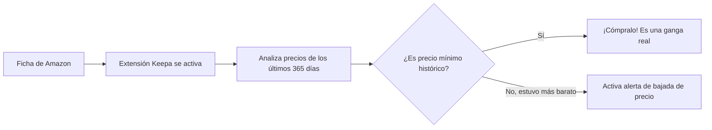

Llega una campaña de rebajas masiva —como el Black Friday, Prime Day o las rebajas de verano— y ves un televisor o un portátil con una llamativa etiqueta roja que anuncia: **"-45% de descuento: de 899 € a solo 499 €"**. Parece una ganga irresistible y te apresuras a comprarlo antes de que se agote.

La cruda realidad es que, en más de la mitad de las ocasiones, estás ante una **oferta inflada artificialmente**: el vendedor subió el precio original a 899 € dos semanas antes de la campaña para simular una rebaja astronómica cuando, durante todo el año, ese mismo producto se vendía habitualmente por 480 €.

Para combatir estas trampas comerciales existen rastreadores de precios automatizados e históricos que analizan cada céntimo que ha costado cualquier producto en Amazon desde el día en que se puso a la venta. En esta guía te mostramos cómo utilizarlos gratis.

> **¿Quieres saber el descuento exacto que te están aplicando?** Realiza cálculos rápidos con nuestra [Calculadora de Porcentajes y Descuentos](/herramientas/calculadora-porcentajes).

---

## Las dos mejores herramientas para rastrear precios en Amazon

| Herramienta | Formato de uso | Historial de precios | Alertas automáticas de bajada | Coste |
| :--- | :--- | :--- | :--- | :--- |
| **Keepa** | Extensión para Chrome, Firefox, Edge y Safari | Gráfico incrustado **directamente dentro de Amazon** | Sí (por email o Telegram) | **100% Gratis** (Funciones básicas) |
| **CamelCamelCamel** | Página web y extensión web | Gráfico externo por URL | Sí (por email) | 100% Gratis |

---

## Cómo instalar y usar Keepa en tu navegador

Keepa es la herramienta definitiva porque no requiere que copies ni pegues ningún enlace:

1. Entra en `keepa.com` o busca en la tienda de extensiones de tu navegador: **"Keepa - Amazon Price Tracker"**.
2. Instala la extensión con un clic.
3. Ahora entra en cualquier ficha de producto de Amazon (por ejemplo, unos auriculares Sony o un móvil Xiaomi).
4. Justo debajo de las fotos principales del producto y del botón de compra, verás aparecer un **gráfico interactivo completo**:
   - **Línea naranja:** Precio vendido directamente por Amazon.
   - **Línea azul:** Precio de vendedores externos nuevos (Marketplace).
   - **Línea negra:** Precio de productos reacondicionados de segunda mano (*Amazon Warehouse*).
5. Puedes cambiar el rango temporal para ver el precio de los últimos **3 meses, 1 año o todo el historial histórico**.

---

## El truco de las Alertas de Bajada de Precio

¿Quieres un producto pero no tienes prisa en comprarlo hoy?

1. En el gráfico de Keepa incrustado en Amazon, haz clic en la pestaña **"Seguimiento del producto" (Track Product)**.
2. Introduce el precio máximo que estás dispuesto a pagar (por ejemplo: *"Avísame si baja de 150 €"*).
3. Introduce tu correo electrónico o vincula tu cuenta de Telegram.
4. En cuanto el algoritmo de precios dinámicos de Amazon aplique una bajada nocturna o una oferta flash a ese importe, **recibirás una notificación instantánea en tu móvil** para comprarlo antes de que suba de nuevo.

---

## Cómo revisar ofertas desde el teléfono móvil

Si compras habitualmente desde la aplicación de Amazon en el smartphone donde no puedes instalar extensiones de Chrome tradicionales:

1. En la app de Amazon, pulsa en el botón **Compartir** de la ficha del producto.
2. Copia el enlace del artículo.
3. Abre tu navegador móvil y entra en `camelcamelcamel.com`.
4. Pega el enlace en su buscador central. Te mostrará de inmediato el precio más alto y el precio más bajo jamás registrado para ese producto.

---

## Preguntas Frecuentes (FAQ)

### ¿Por qué los precios de Amazon cambian tantas veces al día?

**Respuesta**: Amazon utiliza algoritmos automatizados de precios dinámicos basados en inteligencia artificial. Si detecta que una tienda competidora (como MediaMarkt o PcComponentes) rebaja un producto, el algoritmo de Amazon iguala el precio automáticamente en cuestión de minutos, y vuelve a subirlo en cuanto la competencia agota el stock.

### ¿Keepa funciona en todas las webs de Amazon del mundo?

**Respuesta**: Sí. Es compatible con Amazon España (.es), Estados Unidos (.com), Alemania (.de), Reino Unido (.co.uk), Francia (.fr), Italia (.it), México (.com.mx) y la mayoría de regiones internacionales.

### ¿Es seguro instalar la extensión de Keepa en mi ordenador?

**Respuesta**: Sí. Keepa es una de las extensiones más auditadas y veteranas del ecosistema de navegadores, con más de 4 millones de usuarios activos y una estricta política de privacidad que solo lee los identificadores numéricos ASIN de las páginas de productos de Amazon sin recopilar tus datos personales.
