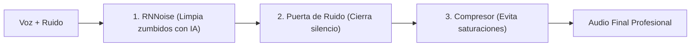

Hacer directos en Twitch o YouTube, grabar podcasts o mantener reuniones de teletrabajo con un micrófono que recoge el zumbido constante de los ventiladores del PC, el tecleo de tu teclado mecánico o el tráfico de la calle arruina por completo la experiencia de tus oyentes.

Muchos tutoriales recomiendan comprar tarjetas gráficas costosas de la gama NVIDIA RTX para utilizar *NVIDIA Broadcast* o gastar cientos de euros en micrófonos con procesadores DSP dedicados.

La realidad es que hoy puedes conseguir una **voz limpia con calidad de estudio de radio de forma 100% gratuita** utilizando modelos de inteligencia artificial ligeros basados en CPU como **RNNoise** y filtros nativos en **OBS Studio** y **Discord**, sin importar si tienes un ordenador modesto o portátil con gráficos integrados.

> **¿Preparas un guion para grabar un vídeo o podcast?** Calcula su duración exacta con nuestra [Calculadora de Tiempo de Lectura y Locución](/herramientas/calculadora-tiempo-lectura-wpm).

---

## Comparativa de supresores de ruido para micrófono

| Sistema | Consumo de Hardware | Calidad de Voz | Coste | Compatibilidad |
| :--- | :--- | :--- | :--- | :--- |
| **Filtro RNNoise (OBS)** | Menos de 1% de CPU | **Excelente** (Voz nítida) | **100% Gratis** | Universal (Cualquier PC) |
| **Discord Krisp** | Muy bajo (Procesado local) | Muy Buena | Gratis en Discord | PC, Mac y Móviles |
| **Puerta de Ruido + Expansor** | 0% de CPU | Buena (pero no quita ruido al hablar) | Gratis | Cualquier mezclador |
| **NVIDIA Broadcast** | Requiere GPU RTX (Tensocores) | Sobresaliente | Exclusivo RTX | Solo tarjetas NVIDIA RTX |

---

## Configuración 1: La cadena de filtros perfecta en OBS Studio

En OBS Studio no basta con aplicar un solo filtro al azar; el orden en que procesas la señal de audio determina el resultado final:

### Paso 1: Añadir el filtro RNNoise (IA ligera)
1. Abre OBS Studio y localiza tu micrófono en el **Mezclador de audio**.
2. Haz clic en los tres puntos verticales al lado del volumen y selecciona **Filtros**.
3. Pulsa en el botón `+` en la esquina inferior y añade **Eliminación de ruido**.
4. En el menú desplegable del método, selecciona: **RNNoise (buena calidad, mayor uso de CPU)**.
5. Este algoritmo neuronal (desarrollado por la Fundación Xiph.Org) consume apenas un 0.5% de CPU y elimina por arte de magia el zumbido de fondo y los chasquidos sin robotizar tu timbre de voz.

### Paso 2: Añadir una Puerta de Ruido (Noise Gate)
1. Pulsa de nuevo en `+` y añade **Puerta antirruido**.
2. **Umbral de clausura:** Ajusta a `-38 dB` (cuando te calles, el micrófono se muteará al 100%).
3. **Umbral de apertura:** Ajusta a `-32 dB` (solo se activará cuando empieces a hablar con volumen normal).

### Paso 3: Añadir un Compresor
1. Añade el filtro **Compresor** con relación 3:1.
2. Esto evitará que cuando te emociones y hables más fuerte o te rías, el audio sature o distorsione en los oídos de tus espectadores.

---

## Configuración 2: Activar la cancelación Krisp en Discord

Discord cuenta con el mejor motor integrado de supresión de ruido del mercado gracias a su alianza con Krisp:

1. Abre Discord y haz clic en el icono del engranaje de **Ajustes de usuario**.
2. Dirígete a **Voz y vídeo**.
3. En la sección *Avanzado*, busca **Supresión de ruido**.
4. Asegúrate de marcar la opción **Krisp** en lugar de Estándar.
5. Desactiva la casilla *"Cancelación de eco"* si utilizas auriculares para evitar que tu voz suene enlatada.

---

## El truco físico que ningún software puede sustituir

Incluso el mejor algoritmo de IA degrada ligeramente los armónicos de la voz si tiene que trabajar demasiado. Para facilitarle el trabajo:

- **Acércate al micrófono:** La regla de oro del sonido es colocar el micrófono a una distancia de entre **10 y 15 centímetros de la boca** con una ganancia baja.
- Al hablar cerca, tu señal de voz es mucho más potente que el ruido ambiental de la habitación (alta relación señal/ruido o SNR), haciendo que los filtros eliminen el fondo sin alterar tus frecuencias naturales.

---

## Preguntas Frecuentes (FAQ)

### ¿Por qué mi voz suena metálica o "robótica" tras activar el filtro?

**Respuesta**: Suele ocurrir cuando la ganancia del micrófono en Windows está configurada al 100% y el ruido de fondo es superior a tu propia voz. Reduce la ganancia del micrófono en los ajustes de sonido de Windows al 70-80%, acerca la cápsula a tu boca y vuelve a calibrar el umbral del filtro RNNoise.

### ¿Puedo usar el filtro RNNoise en llamadas de Google Meet o Zoom?

**Respuesta**: Sí. Puedes instalar la herramienta gratuita **SteelSeries Sonar** o configurar un cable virtual con **Voicemeeter Banana** y el plugin VST libre *ReaFIR*, seleccionando el cable virtual como micrófono de entrada en Zoom o Teams para aplicar la limpieza en tiempo real en cualquier aplicación.

### ¿Los filtros de ruido aumentan el retardo (latencia) de mi voz?

**Respuesta**: En el caso de RNNoise y Krisp, el procesamiento toma entre **10 y 20 milisegundos**, una cifra absolutamente imperceptible para el oído humano durante conversaciones en directo o partidas multijugador online.
