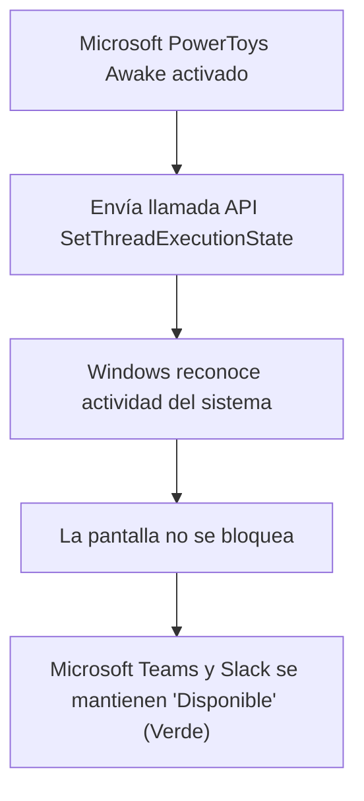

Cualquier profesional que trabaje en remoto o híbrido se ha enfrentado a esta molesta situación: estás leyendo un informe extenso en papel, analizando un gráfico en una pizarra o simplemente te levantas un momento a preparar un café, y cuando vuelves al escritorio, **Windows ha bloqueado la sesión por inactividad y tu estado en Microsoft Teams o Slack ha cambiado automáticamente a "Ausente" (círculo amarillo)**.

En muchos entornos corporativos, las políticas de seguridad del departamento de informática (GPO de Active Directory) tienen bloqueado el cambio del tiempo de suspensión de pantalla en el Panel de Control, impidiendo al usuario subir el límite de 5 minutos.

Para evitar recurrir a programas sospechosos o "mouse jigglers" físicos que pueden saltar en las auditorías de software de la empresa, Microsoft dispone de una herramienta oficial, 100% legal y de código abierto llamada **PowerToys Awake**.

En esta guía te enseñamos a configurarla y otros métodos limpios para que tu ordenador permanezca activo el tiempo que tú decidas.

> **¿Necesitas medir tus descansos con la técnica Pomodoro?** Utiliza nuestro [Cronómetro y Temporizador Online](/herramientas/cronometro-temporizador).

---

## Comparativa de métodos para mantener el PC despierto

| Método | ¿Permitido en PCs de Empresa? | ¿Requiere Permisos de Administrador? | Riesgo de Auditoría IT |
| :--- | :--- | :--- | :--- |
| **Microsoft PowerToys Awake** | **SÍ (Software Oficial de Microsoft)** | No (Se puede instalar por usuario) | **0% (Firma legítima de Microsoft)** |
| **Presentación de PowerPoint en bucle** | **SÍ (Nativo de Office)** | No (No instala nada) | **0% (Función estándar)** |
| **Mouse Jiggler físico USB** | Parcial | No requiere drivers | Puede alertar si monitorizan USBs |
| **Scripts no firmados (.vbs / .exe)** | **NO** | No | 🔴 **Alto (Puede ser detectado como malware)** |

---

## Método 1: Microsoft PowerToys Awake (La solución oficial definitiva)

**Awake** es una utilidad desarrollada por el equipo de ingeniería de Microsoft dentro de la suite de código abierto *Microsoft PowerToys*. Su función es reportar al núcleo del sistema operativo una llamada a la API `SetThreadExecutionState` para indicarle que el equipo está realizando una tarea activa en primer plano:

### Paso 1: Instalar Microsoft PowerToys
1. Abre la **Microsoft Store** en Windows 11 o Windows 10.
2. Busca e instala la aplicación gratuita oficial: **Microsoft PowerToys** (o descárgala desde el GitHub oficial de Microsoft: `github.com/microsoft/PowerToys`).

### Paso 2: Activar y configurar Awake
1. Abre PowerToys y en el menú lateral izquierdo haz clic en **Awake**.
2. Activa el interruptor principal: *"Habilitar Awake"*.
3. En la sección **Modo**, dispones de tres opciones muy cómodas:
   - **Mantener activo de forma indefinida:** El ordenador no se apagará ni bloqueará nunca hasta que tú cierres la sesión manualmente.
   - **Mantener activo con temporizador:** Puedes fijar que permanezca despierto durante 1 hora, 2 horas o hasta el final de tu jornada laboral (ej. a las 18:00).
4. Asegúrate de marcar la casilla: **"Mantener la pantalla encendida"**.
5. Verás aparecer un pequeño icono de una taza de café azul en la barra de tareas de Windows: haciendo clic derecho sobre él puedes encenderlo o apagarlo en un segundo.

---

## Método 2: El truco de la presentación de PowerPoint (Cero instalaciones)

Si tu ordenador de empresa tiene las tiendas y descargas completamente bloqueadas por el administrador de sistemas:

1. Abre **Microsoft PowerPoint** y crea una diapositiva en blanco.
2. Ve a la pestaña **Presentación con diapositivas > Configuración de la presentación con diapositivas**.
3. Marca la casilla: **"Examinada de forma individual (ventana)"** o *"Examinada en quiosco (pantalla completa)"*.
4. Inicia la presentación pulsando la tecla **F5**.
5. Por diseño de ingeniería de Windows, **ninguna pantalla entra en suspensión ni bloquea sesión mientras haya una presentación de diapositivas activa**. Puedes minimizar la ventana y continuar trabajando sin que el estado de Teams cambie a ausente.

---

## Método 3: Reproducir un vídeo largo en bucle en Windows Media Player

Un principio idéntico al de PowerPoint: el reproductor multimedia de Windows desactiva la suspensión para permitir ver películas sin interrupciones:

1. Abre cualquier clip de vídeo en el reproductor nativo de Windows (incluso un vídeo corto de 10 segundos).
2. Activa la opción de **Reproducción en bucle (Repetir)**.
3. Baja el volumen a cero y minimiza el reproductor. La sesión permanecerá encendida de forma constante.

---

## Preguntas Frecuentes (FAQ)

### ¿El departamento de IT puede sancionarme por usar PowerToys Awake?

**Respuesta**: No, porque Microsoft PowerToys es una herramienta de código abierto desarrollada y firmada digitalmente por la propia Microsoft Corporation para optimizar flujos de trabajo en Windows. No inyecta código malicioso ni simula movimientos falsos de ratón, sino que utiliza los mismos comandos legítimos de ahorro de energía que emplean los programas de edición de vídeo o reproductores de presentaciones.

### ¿Tener la pantalla siempre encendida gasta mucha energía en el portátil?

**Respuesta**: Si trabajas con la batería desenchufada, mantener la pantalla a brillo máximo consumirá la autonomía un 30% más rápido. Sin embargo, en un ordenador conectado a la corriente o mediante cargador USB-C, el consumo adicional de mantener el panel encendido es de apenas unos pocos vatios al día.

### ¿Teams detecta si estoy usando un simulador de movimiento de ratón?

**Respuesta**: Las aplicaciones corporativas no leen el hardware del ratón, pero ciertos sistemas de telemetría empresarial avanzada (como softwares de monitorización de productividad tipo Hubstaff o Time Doctor) analizan patrones mecánicos repetitivos (por ejemplo, si el cursor se mueve cada exactamente 60 segundos 5 píxeles a la derecha en bucle). Por ello, herramientas pasivas a nivel de sistema operativo como Awake o el modo presentación son infinitamente más naturales y seguras.
