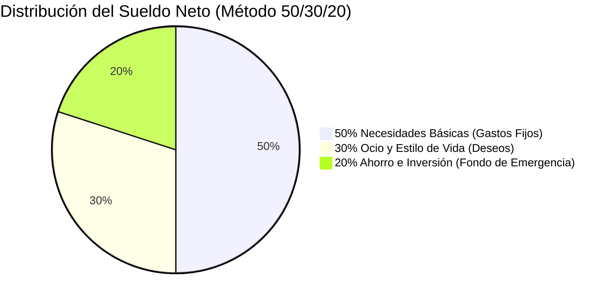

Llegar a final de mes con la sensación de no saber a dónde se ha ido el dinero de la nómina es una de las mayores fuentes de estrés financiero cotidiano. Muchas personas intentan solucionarlo descargando aplicaciones móviles complejas con suscripciones de pago que acaban abandonando a las dos semanas por falta de constancia.

La solución más duradera y respaldada por expertos en economía conductual no requiere herramientas caras: se llama **la regla o método 50/30/20**, popularizada por la catedrática de Harvard Elizabeth Warren. 

A continuación te explicamos exactamente cómo categorizar tus ingresos netos y poner en marcha este sistema en menos de 15 minutos.

> **Punto de partida fundamental:** Para aplicar este método debes conocer con exactitud tus ingresos limpios mensuales. Si trabajas por cuenta ajena o necesitas calcular retenciones, utiliza nuestra [Calculadora de Sueldo Neto y Nómina](/herramientas/calculadora-sueldo-neto).

---

## ¿En qué consiste la regla presupuestaria 50/30/20?

El método divide tus **ingresos netos disponibles** (el dinero que efectivamente entra en tu cuenta bancaria tras impuestos y Seguridad Social) en tres cubos o categorías bien diferenciadas:

---

## 1. El 50%: Necesidades Básicas y Obligaciones Ineludibles

Son todos aquellos gastos indispensables para vivir y mantener tu trabajo. Si mañana perdieras tus ingresos, tendrías que seguir pagándolos sí o sí:

- **Vivienda:** Alquiler mensual o cuota hipotecaria.
- **Suministros del hogar:** Luz, agua, gas e internet doméstico.
- **Alimentación básica:** Compra mensual en el supermercado (excluyendo cenas en restaurantes).
- **Transporte esencial:** Abono de transporte público, gasolina o seguro básico del vehículo para ir a trabajar.
- **Deudas prioritarias mínimas:** Cuotas obligatorias de préstamos existentes.

> **Regla de oro:** Si tus necesidades básicas superan el 50% de tu sueldo (algo habitual por el precio del alquiler en grandes ciudades como Madrid o Barcelona), debes ajustar temporalmente a una fórmula **60/20/20** o buscar alternativas de reducción de suministros.

---

## 2. El 30%: Deseos, Ocio y Calidad de Vida

El gran acierto del método 50/30/20 es que **no te priva del disfrute**. La mayoría de presupuestos fracasan porque son excesivamente estrictos. Este 30% está reservado para que lo gastes sin ninguna culpa:

- Salidas a cenar y cafés con amigos.
- Suscripciones digitales (Netflix, Spotify, gimnasio, videojuegos).
- Ropa no esencial o compras por placer.
- Viajes, escapadas de fin de semana y entradas de cine.

---

## 3. El 20%: Ahorro a Futuro, Inversión y Liquidación de Deudas

Este dinero no se toca para el día a día. Debe salir de tu cuenta de gastos habituales en el mismo momento en que cobras la nómina:

1. **Fondo de emergencia:** Tu primera meta debe ser acumular entre 3 y 6 meses de tus gastos fijos (el cubo del 50%) en una cuenta remunerada sin riesgo.
2. **Amortización de deudas abusivas:** Si tienes tarjetas de crédito revolving o préstamos con intereses altos, este 20% debe ir a amortizarlos de inmediato.
3. **Inversión indexada a largo plazo:** Una vez cubierto el fondo de emergencia, canaliza este capital hacia fondos indexados globales (MSCI World, S&P 500) o planes de jubilación.

---

## Ejemplo práctico con un sueldo neto de 1.800 € al mes

Veamos cómo se repartiría exactamente el dinero con una nómina estándar en España:

| Categoría | Porcentaje | Importe Mensual | Destino del Dinero |
| :--- | :--- | :--- | :--- |
| **Necesidades** | 50% | **900 €** | 650 € alquiler + 150 € comida + 100 € suministros |
| **Deseos (Ocio)** | 30% | **540 €** | Restaurantes, cine, hobbies y compras personales |
| **Ahorro / Inversión** | 20% | **360 €** | 200 € fondo de emergencia + 160 € fondo indexado |
| **Total Nómina** | 100% | **1.800 €** | Equilibrio financiero absoluto |

---

## El truco de la automatización bancaria (El "págate a ti mismo primero")

Para que este método funcione de forma automática sin mirar números todos los días:

1. **Configura dos cuentas bancarias:** Una cuenta principal de ingresos/gastos fijos y una cuenta secundaria de ahorro (en bancos online sin comisiones).
2. **Programa una transferencia periódica automática:** Haz que el día 1 de cada mes (justo tras cobrar la nómina), el 20% se transfiera de forma automática a tu cuenta de ahorro remunerada.
3. Al vivir con el 80% restante ya equilibrado entre gastos fijos y ocio, ahorrarás mes tras mes sin darte cuenta ni sufrir privaciones.

---

## Preguntas Frecuentes (FAQ)

### ¿Qué hago si mi alquiler ya se come más del 50% de mi sueldo?

**Respuesta**: En épocas de inflación o precios de vivienda elevados, aplica la adaptación flexible **60/20/20** (60% necesidades, 20% ocio y 20% ahorro). Lo fundamental es no recortar nunca el 20% destinado al ahorro y fondo de emergencia, sino ajustar el ocio y recortar gastos superfluos de suministros o suscripciones innecesarias.

### ¿Las cuotas del gimnasio se consideran necesidad o deseo?

**Respuesta**: Salvo prescripción médica expresa para rehabilitación de una lesión, las cuotas de gimnasio, plataformas de streaming y compras de moda pertenecen a la categoría del 30% de Deseos y Calidad de vida.

### ¿Dónde es mejor guardar el 20% de ahorro cada mes?

**Respuesta**: Nunca lo dejes quieto en una cuenta corriente tradicional que pague 0% de interés porque la inflación se comerá su valor. Lo recomendable es transferirlo a una cuenta de ahorro remunerada (que actualmente ofrecen entre un 2.5% y un 3.5% TAE) con total disponibilidad inmediata de tu dinero.
