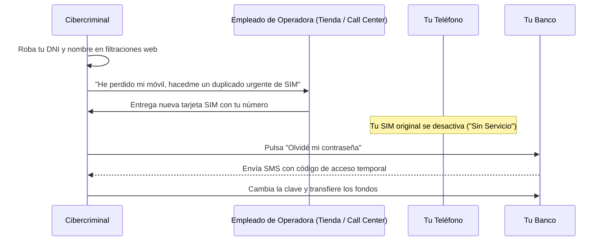

Estás tranquilamente en casa y de pronto notas que la cobertura de tu teléfono móvil desaparece por completo: en la barra superior aparece el inquietante mensaje **"Sin Servicio"** o *"Solo llamadas de emergencia"*. Crees que se trata de una avería momentánea de tu compañía telefónica y decides no darle importancia hasta el día siguiente.

A la mañana siguiente descubres con horror que no puedes acceder a la aplicación de tu banco y que han transferido miles de euros mediante transferencias inmediatas y compras online con Bizum.

Has sido víctima de un **SIM Swapping (duplicado malicioso de SIM)**, el ciberataque más peligroso de la actualidad que inutiliza el método de seguridad que la mayoría de bancos y plataformas siguen utilizando por defecto: los códigos de verificación por SMS.

En esta guía te explicamos cómo ejecutan este engaño los estafadores y los 4 pasos indispensables para blindar tu número de teléfono.

> **Regla de oro de ciberseguridad:** No reutilices la misma clave en tus correos y banca online. Crea credenciales únicas con nuestro [Generador de Contraseñas Seguras](/herramientas/generador-contrasenas).

---

## ¿Cómo funciona el ataque de SIM Swapping?

El ataque no requiere hackear físicamente tu terminal; se basa en la **ingeniería social dirigida a los empleados de las compañías telefónicas**:

En cuanto la nueva tarjeta SIM del atacante se conecta a la red móvil de telefonía, **tu tarjeta SIM física se desactiva de inmediato**. Desde ese instante, todas tus llamadas y, lo que es peor, todos los códigos SMS de confirmación bancaria llegan al móvil del delincuente.

---

## 4 Pasos obligatorios para blindar tu cuenta contra el SIM Swap

### 1. Desvincula el SMS de tus cuentas críticas y usa Apps Authenticator
El SMS es un protocolo de los años 90 sin encriptar y vulnerable a suplantaciones. Cámbialo en tus cuentas de Google, Apple, WhatsApp y exchanges por aplicaciones de códigos temporales basados en tiempo (TOTP):
- **Google Authenticator**, **Microsoft Authenticator** o **Bitwarden**.
- Estos códigos se generan en el procesador físico de tu teléfono y son completamente inmunes a un duplicado de SIM.

### 2. Activa una contraseña o PIN verbal en tu operadora telefónica
Ponte en contacto con el servicio de atención al cliente de tu compañía (Movistar, Vodafone, Orange, Yoigo, Claro, etc.) y solicita:
- *"Deseo activar una palabra clave o PIN de seguridad para cualquier trámite de duplicado de SIM"*.
- Con esta protección, aunque un desconocido se presente en una tienda física con una copia falsa de tu DNI, los empleados no podrán emitir una nueva tarjeta sin esa contraseña secreta verbal.

### 3. Cambia el PIN por defecto de tu tarjeta SIM
Muchas personas mantienen el PIN original `0000` o `1234` que venía en la tarjeta de plástico. Cámbialo de inmediato desde **Ajustes > Seguridad > Bloqueo de tarjeta SIM** por un código de 4 dígitos aleatorio para evitar que utilicen tu SIM si te roban el móvil físicamente.

### 4. Mantén en secreto tu correo electrónico principal
No publiques tu dirección de correo electrónico personal vinculada a tus cuentas bancarias en redes sociales ni en foros de compraventa de segunda mano como Wallapop o Vinted.

---

## ¿Qué hacer de urgencia si tu móvil se queda "Sin Servicio" sin motivo?

Si estás en una zona con buena cobertura habitual y tu móvil pierde la señal de repente:

1. **Llama inmediatamente a tu operadora desde otro teléfono:** Pregunta de forma directa: *"¿Se ha solicitado recientemente un duplicado de tarjeta SIM en mi línea?"*.
2. Si te confirman que sí, **ordena el bloqueo inmediato de la línea**.
3. **Entra en la app de tu banco desde el ordenador** y bloquea tus tarjetas de crédito y transferencias salientes.

---

## Preguntas Frecuentes (FAQ)

### ¿El banco se hace responsable del dinero robado por SIM Swapping?

**Respuesta**: Sí, en la inmensa mayoría de los casos. La jurisprudencia y las resoluciones del Banco de España y tribunales europeos determinan que el banco y las operadoras de telecomunicaciones tienen una responsabilidad civil objetiva por falta de diligencia al autorizar duplicados sin verificar la presencia real del cliente. Salvo que demuestren negligencia grave por parte del usuario, el banco está legalmente obligado a restituir los importes sustraídos.

### ¿Tener una eSIM electrónica evita el ataque de SIM Swap?

**Respuesta**: Dificulta el robo físico de la tarjeta, pero no erradica el SIM Swapping por ingeniería social. Si el atacante engaña a la operadora para que emita un código QR de activación de una nueva eSIM en su propio dispositivo, la tuya quedará igualmente desactivada en el acto.

### ¿Recibir llamadas de números desconocidos puede duplicar mi tarjeta?

**Respuesta**: No, descolgar una llamada no permite clonar una tarjeta SIM. Los delincuentes utilizan esas llamadas para obtener grabaciones de tu voz o sonsacarte datos personales mediante técnicas de *Vishing*, pero necesitan engañar formalmente a tu compañía telefónica para emitir la tarjeta duplicada.
